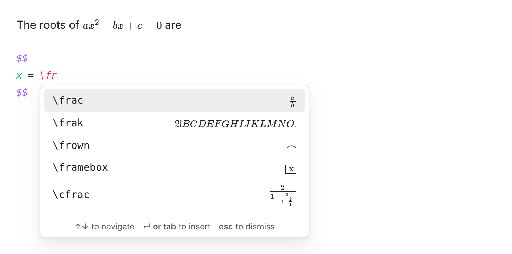
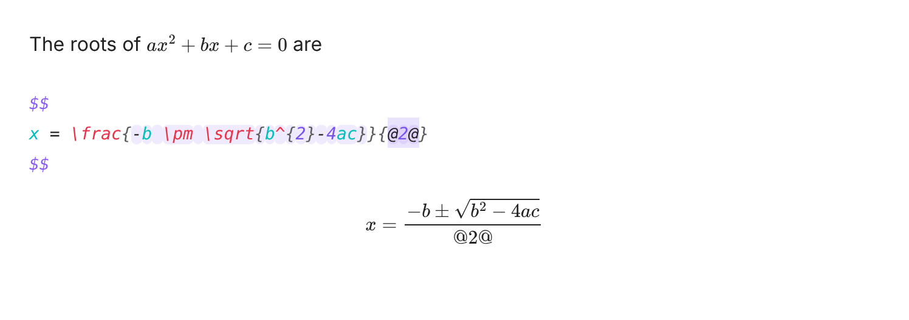
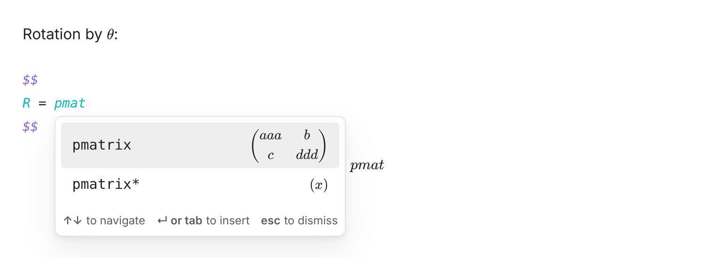
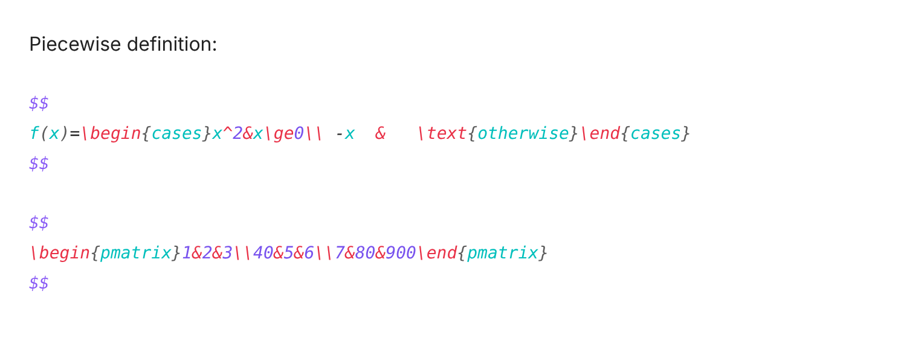
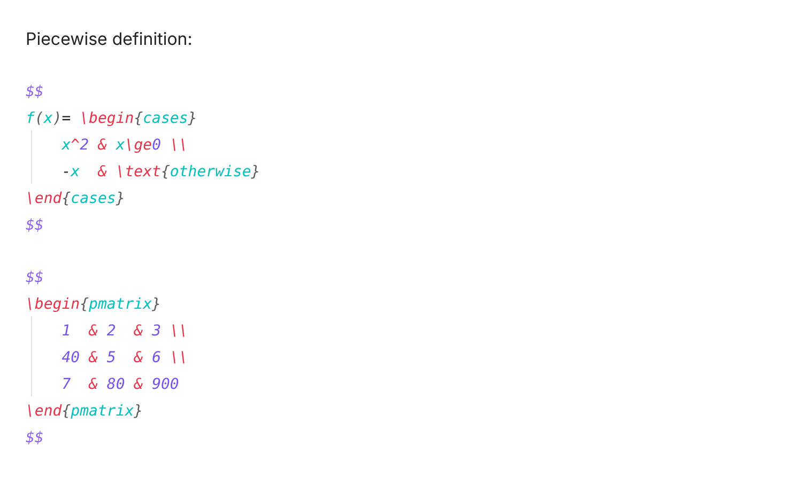
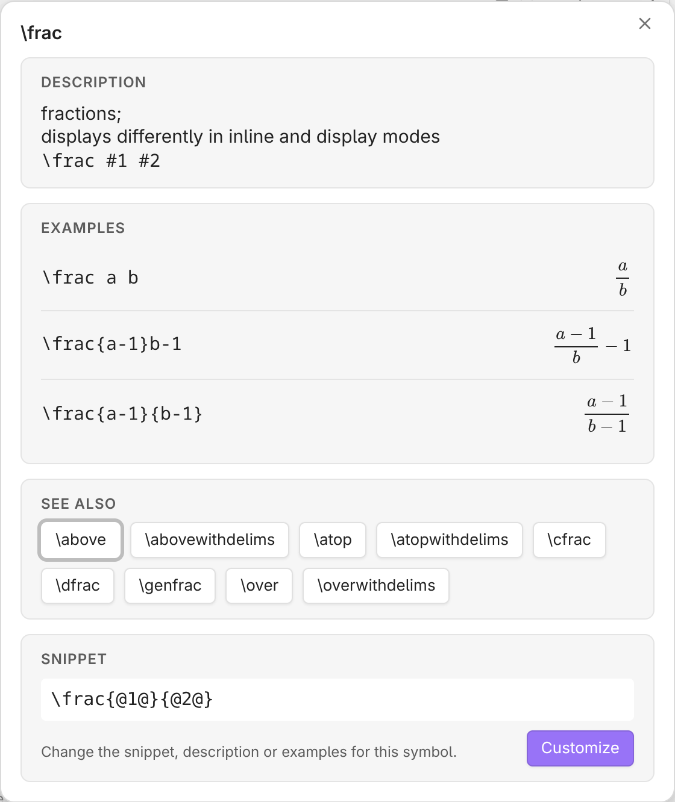
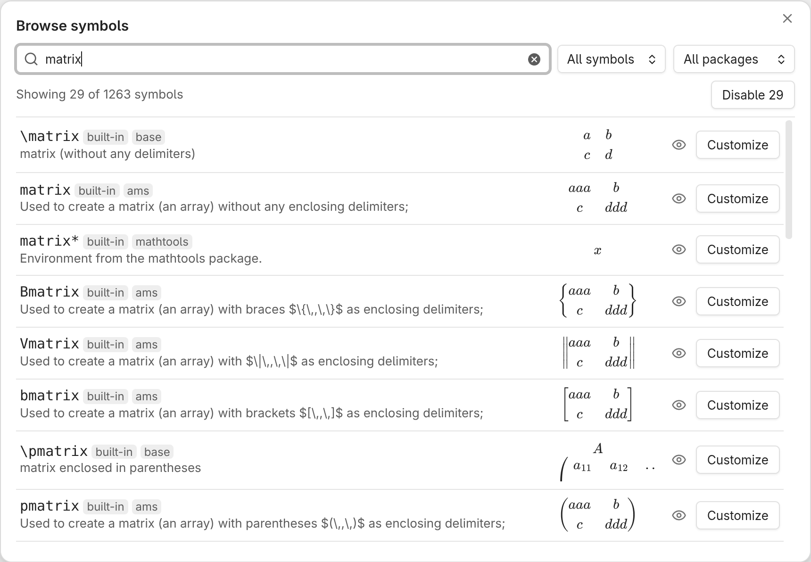
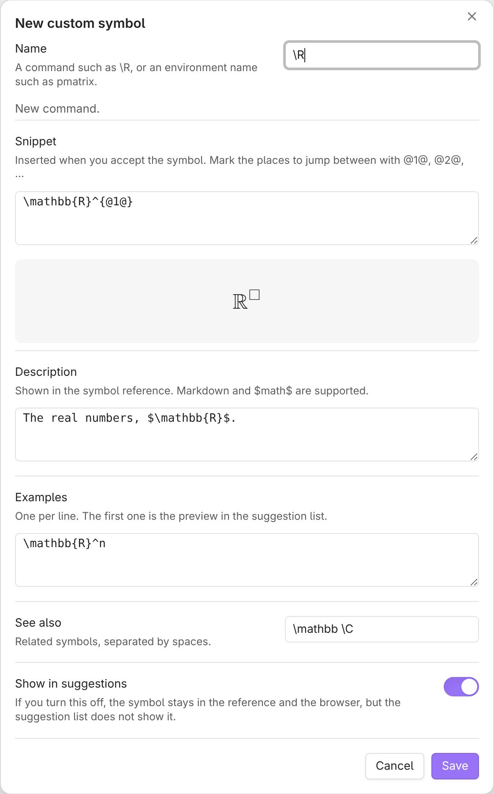
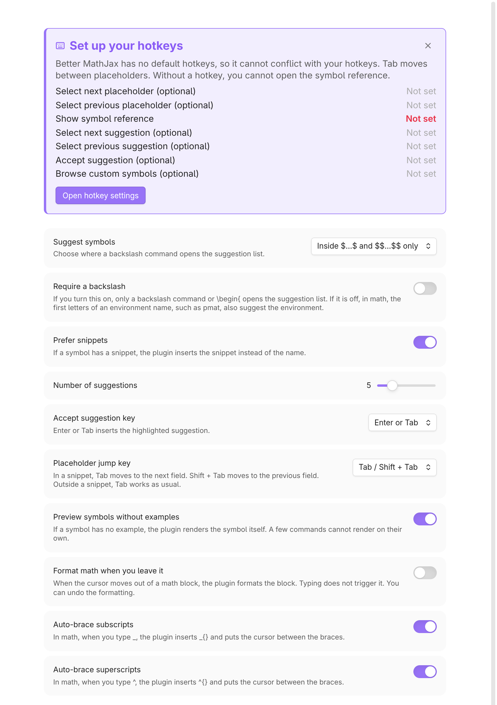

# Better MathJax features

This page shows every feature of Better MathJax. For setup and upgrade notes, see the [README](../README.md).

- [Suggestions](#suggestions)
- [Snippets and fields](#snippets-and-fields)
- [Environments](#environments)
- [Auto-braces](#auto-braces)
- [Formatting](#formatting)
- [Symbol reference](#symbol-reference)
- [Symbol browser](#symbol-browser)
- [Custom symbols](#custom-symbols)
- [Where the plugin keeps custom symbols](#where-the-plugin-keeps-custom-symbols)
- [Backups](#backups)
- [Hotkeys](#hotkeys)

## Suggestions

Type a backslash command in `$…$` or `$$…$$`. A list of matching symbols opens, and each row shows a rendered preview.

The plugin ignores dollar signs in code blocks, inline code and the frontmatter. It also ignores an escaped `\$`. To get suggestions in all text, change *Suggest symbols* in the settings.

The list puts an exact match first, then names that start with what you typed, then names that contain it. Letter case counts, so `\delta` and `\Delta` are different suggestions.



## Snippets and fields

When you accept `\frac`, the plugin inserts `\frac{@1@}{@2@}` and selects the first field.

- Press `Tab` to go to the next field and `Shift+Tab` to go to the previous field.
- To use other keys, set *Placeholder jump key* to *Hotkeys*. Then assign keys to the placeholder commands.
- A field stays highlighted after you type in it, so you can go back and correct it.
- If you insert a snippet in a field, you fill that snippet first. Then you continue with the outer snippet.

The snippet ends when you move the cursor out of it. It also ends when you press *next* on the last field after you fill all fields. The cursor then goes to the end of the snippet.

Outside a snippet, *next* goes to the next `@n@` marker in the note. If there is no marker, it goes past the next `}` on the line.



## Environments

In math, type the first letters of an environment name without a backslash, for example `pmat`. Select `pmatrix` to insert a full `\begin{pmatrix} … \end{pmatrix}` block. You can also type `\begin{pm`.

The list shows only environment names that start with the letters you typed. Thus a variable such as `ab` does not open the list. Words in usual text never open it. To get suggestions only after a backslash, turn on *Require a backslash*.

In blockquotes and callouts, each inserted line keeps the `>` prefix.



## Auto-braces

In math, type `_` or `^`. The plugin inserts `_{}` or `^{}` and puts the cursor between the braces. If you select text first, the braces go around the selected text.

When you type `}` just before the closing brace, the cursor moves past it, and the plugin adds no second brace. This works until the cursor goes to a different line.

## Formatting

*Format math at cursor* formats the math block that contains the cursor. *Format all math in note* formats all math blocks in the note.

The formatter makes these changes and no others:

- It indents the body of each environment and puts each row on its own line.
- It aligns the `&` columns.
- It changes a sequence of spaces to one space.

The formatted math renders the same as before. Indentation follows the Obsidian settings *Indent using tabs* and *Tab indent size*. Math in blockquotes and callouts keeps its `>` prefix. In inline math, the formatter changes only the spaces. One undo reverts all of the changes.

Turn on *Format math when you leave it* to format a block when the cursor leaves it. Arrow keys, a click and a jump all count. Typing never starts a format. This option is off by default.

 

## Symbol reference

Run *Show symbol reference*. A window shows the description, the rendered examples, the related symbols and the snippet. It shows the symbol that you highlight in the suggestion list, or the command at the cursor. Click *Customize* to open the symbol in the editor.



## Symbol browser

Run *Browse all symbols*, or click *Browse symbols* in the settings. The browser lists all symbols, built-in and your own. There are about 1,260 built-in symbols.

- Search by name or description.
- Filter by source (built-in, customized, your own, disabled) or by MathJax package.
- Each row shows a preview and a *Customize* or *Edit* button.
- The eye icon turns a symbol off or on.

A disabled symbol does not show in the suggestion list. It stays in the browser and in the symbol reference.

When you filter the list, *Disable N* and *Enable N* change all symbols in the list at the same time. For example, you can turn off a full package that you do not use. The editor has the same switch, *Show in suggestions*.



## Custom symbols

You can add your own commands. You can also change the snippet, description or examples of a built-in symbol. You do not need to edit JSON.

- **Add custom symbol** opens a form with a live preview of the snippet. Run the command, or click *Add symbol* in the settings. If the cursor is on a command such as `\frac`, the form starts from that symbol.
- **Browse custom symbols** searches all symbols and lists your own first. Run the command. If you type a name that does not exist, the browser offers to create it.
- **Customize** in the symbol reference opens the same form for that symbol.

For a built-in symbol, an empty field keeps the built-in value. *Reset to built-in* removes your changes.

The plugin saves a disabled symbol as `{"name": "\\textcent", "disabled": true}`.



## Where the plugin keeps custom symbols

Select a location in the settings, under *Where symbols are stored*.

- **Hidden (plugin settings).** This is the default. The plugin saves the symbols in `.obsidian/plugins/better-mathjax/data.json`, so they do not show among your notes. Use the commands above to edit them.
- **Note in your vault.** The symbols are in a note, `Better MathJax Symbols.md` by default. A `jsonl` code block in the note holds one symbol on each line:

  ````markdown
  ```jsonl
  {"name":"\\R","snippet":"\\mathbb{R}^{@1@}","description":"The real numbers."}
  {"name":"\\E","snippet":"\\mathbb{E}\\left[@1@\\right]"}
  ```
  ````

  You, or an AI agent that can edit your notes, can change the block directly. The plugin applies a change when you save the note.

  - If a line is not valid, the plugin skips it and shows the line number. The other lines continue to work.
  - When the plugin saves a symbol, it changes only that line. The rest of the note stays as you wrote it.
  - If you rename or move the note in Obsidian, the plugin follows it.

When you change the location, the plugin moves your symbols. To move them from the note back to hidden storage, every line of the note must be valid.

- If all lines are valid, the plugin moves the symbols into the plugin settings and sends the note to the trash.
- If a line has a problem, the plugin changes nothing. A warning shows the lines that you must correct.

## Backups

Before a change replaces or removes a symbol, the plugin saves a backup. The backups are in `.obsidian/plugins/better-mathjax/backups/`, so they do not show among your notes.

- The plugin compares your symbols before and after each change. A change that only adds symbols does not make a backup.
- These changes can make a backup:
  - a save in the editor
  - an import or a restore
  - a change of storage location
  - an edit of the symbol note from outside the plugin, for example by an agent
- A series of quick outside edits makes one backup.
- The plugin keeps the 10 newest backups.

Click *Restore…* in the settings, or run *Restore custom symbols from backup*. The list shows the backups, newest first. Click *Restore* to restore a backup. To delete a backup, click *Delete* and then *Confirm*.

If a restore replaces or removes a symbol, the plugin first backs up your current symbols. Thus you can undo a restore.

## Hotkeys

The plugin does not set hotkeys. Assign them in *Settings → Hotkeys*. The guide at the top of the plugin settings shows which hotkeys you set. These are examples:

| Command | Example hotkey |
|---|---|
| Select next suggestion | `Ctrl+]` |
| Select previous suggestion | `Ctrl+[` |
| Accept suggestion | any key |
| Select next placeholder | `Ctrl+'` |
| Select previous placeholder | `Ctrl+;` |
| Show symbol reference | `Ctrl+Shift+/` |

These commands have no example hotkey:

- *Format math at cursor* and *Format all math in note*
- *Browse all symbols* and *Browse custom symbols*
- *Add custom symbol* and *Open symbol note*
- *Import custom symbols from note* and *Restore custom symbols from backup*

In the suggestion list:

- `↑`, `↓` and `Enter` always work.
- `Tab` also accepts a suggestion. To stop this, set *Accept suggestion key* to *Enter or hotkey* and assign a key to *Accept suggestion*.
- The suggestion commands work only while the list is open. Their keys do their usual job at all other times.

In a snippet, `Tab` and `Shift+Tab` move between fields. While the suggestion list is open, `Tab` accepts the suggestion. The editor handles `Tab` itself, not as an Obsidian hotkey. Thus `Tab` indents as usual outside a snippet. To use other keys for fields, set *Placeholder jump key* to *Hotkeys* and assign keys to *Select next placeholder* and *Select previous placeholder*.


